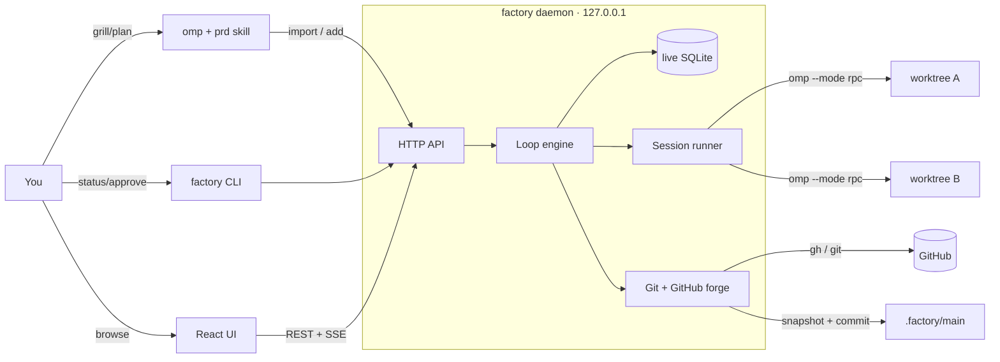
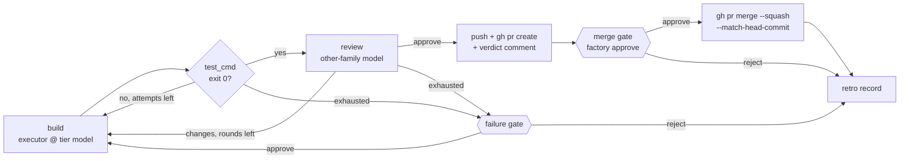

# Software factory: architecture and decision log

A living design doc. Read it before you change the daemon, CLI, or UI, and update it in the same PR when you change something it describes. The planner (sf8) and the learn gate (sf10) read and update it too. Where this doc and the code disagree, the code wins: fix the doc.

## 1. Purpose and scope

The factory is a local system that runs SDLC loops as DAGs: **Intake → Plan → Split → Build → Verify → Merge → Learn**. A human briefs and approves; a planner (a model) plans; the orchestrator (the daemon, not a model) runs the plan; executors (models) build one step each. Loops nest: a loop can spawn child loops whose output is a decision, a doc, a wireframe, or code.

**v0 does:**
- Runs one hard-coded loop template, `change`: build → test → review → PR → merge gate → merge → retro.
- Stores work items, deps, runs, node runs, gates, events, and retros in one SQLite DB, committed to `main` as `.factory/factory.db`.
- Imports YAML PRDs (`factory import`) and takes ad-hoc items (`factory add`).
- Dispatches explicitly started (`factory start`) items as their deps finish, at most `loop.maxParallel` at a time.
- Serves a read-only React UI with live updates over SSE.

**v0 does not:** plan (no planner, no plan gate), nest loops, produce non-code artifacts, apply retro learnings, approve from the UI, configure gates per node, restart itself after a self-merge, or use any harness other than omp. One user, one workstation, localhost only, GitHub only. Those are the v1 backlog (section 9).

## 2. Process model

| Process | What it is |
|---------|-----------|
| `factory daemon` | One Node process per repo (`npm run daemon --prefix factory` or `factory daemon`). Binding `127.0.0.1:<port>` (default 7317) **is** the single-instance lock; there is no pidfile. Serves `/api/*` JSON, `/events` SSE, and `factory/ui/dist` with SPA fallback. The only process that opens the live DB. |
| `factory` CLI | Thin HTTP client: `daemon`, `status`, `show`, `add`, `import`, `start`, `approve`, `reject`. Never touches the DB or git. Exit codes: 1 API or import error, 2 daemon unreachable, 64 usage. |
| UI | Vite + React SPA in `factory/ui`. Reads REST snapshots, then follows one shared `EventSource('/events')`. Read-only: no mutating requests. |
| omp sessions | `omp --mode rpc` children of the daemon, one per build or review node, in the item's worktree. Spawned `detached` so a process-group kill reaches grandchildren. |

**Startup order** (`main.ts`): resolve paths → load config → seed `live/factory.db` from the committed DB if missing → open DB, bus, store, HTTP server → **acquire the instance lock** → validate the reviewer mapping → `forge.ensureMainWorktree()` → create the state committer → register shutdown hooks → create the engine → `engine.start()`. The lock comes before `ensureMainWorktree` so that a losing second daemon never resets `.factory/main`.

**Shutdown** (SIGTERM/SIGINT): hooks run in reverse registration order under a shared 10 s grace deadline: `engine.stop()` (stop dispatching; it does not wait for in-flight runs) → `killAllSessions()` (SIGTERM to every live executor group) → committer `stop()` + `flush('shutdown')`. A hook error is logged and the rest still run. After `engine.stop()`, runs stop writing state, so sessions killed at shutdown re-run on restart instead of counting as failed builds. No systemd unit ships; a `--user` unit with `KillMode=control-group` is an optional backstop.

**SSE**: each persisted event's `id:` is its `seq`; `Last-Event-ID` (or `?after=<seq>`) replays missed events. Executor tool calls stream as `event: activity` frames with no `id`; they are never persisted.

**HTTP API** (`http.ts`): `GET /api/health`, `GET|POST /api/items`, `POST /api/items/batch` (idempotent on `source_ref`), `GET|PATCH /api/items/:id`, `POST /api/items/:id/deps` (cycle-checked), `DELETE /api/items/:id/deps/:depends_on_id` (404 if the edge is absent), `GET /api/runs`, `GET /api/runs/:id`, `GET /api/gates`, `POST /api/gates/:id/decision`, `GET /api/events`. Bodies over 1 MiB get `413 too_large` and the connection is closed. PATCH applies field updates, then the CAS status transition; the two are not atomic.

## 3. Git topology

| Path | Tracked? | Owner | Purpose |
|------|----------|-------|---------|
| `.factory/factory.db` | committed | daemon (via snapshot) | Source of truth, shared by clones |
| `.factory/config.json` | committed | human | Port, role→model map, caps, loop limits, state-commit settings, default test command |
| `.factory/main/` | gitignored | daemon | Worktree at **detached HEAD = `origin/main`**. Your checkout already has `main` checked out, and a branch can be checked out in only one worktree. Pushes go out as `git push origin HEAD:main`. |
| `.factory/live/` | gitignored | daemon | Live WAL DB (`factory.db`, `-wal`, `-shm`) |
| `.factory/worktrees/<item>-<attempt>/` | gitignored | executor | `git worktree add --lock -b factory/<item>-<attempt> <path> origin/main` |
| `.factory/sessions/` | gitignored | omp | Full transcripts (`--session-dir`); the DB stores only the path |

- **One git queue.** Every fetch, sync, push, merge, and state commit goes through one in-process FIFO (`createQueue` in `git.ts`; a failed job does not break the chain). Executors only commit on their own branch; the daemon pushes branches. The user's checkout is never modified: only `fetch`, `worktree` admin commands, and `gh` run at the repo root. You `git pull` to see the factory's work.
- **Snapshot and commit** (`state-commit.ts`). Milestone events (run created, run reaches `completed|failed|cancelled`, PR number set, gate opened/closed, retro recorded) are batched with a 60 s debounce. A merge flushes immediately (`merged #<id>`), and so does shutdown. One flush, inside the queue: fetch, `reset --hard origin/main`, `clean -fd` in `.factory/main`; `VACUUM INTO` a temp file, set `journal_mode=DELETE`, rename it over `.factory/main/.factory/factory.db`; `PRAGMA integrity_check`; stage; skip if nothing changed; commit `factory: state (<milestones, ≤200 chars>)`; `push origin HEAD:main`. A rejected push that matches `non-fast-forward|[rejected]|fetch first|incorrect old value` is retried once from the fetch. On failure the batch stays pending for the next flush.
- **Seeding.** On startup, if `live/factory.db` is missing, it is copied from the committed file.
- **Unsigned factory commits.** Every daemon commit (state commits and executor-branch commits via `commitAll`) uses `DAEMON_COMMIT_FLAGS` from `git.ts`: identity `factory <factory@localhost>` and `-c commit.gpgsign=false`. Executor commits reach `main` only through GitHub's squash merge, which GitHub signs, so only `factory: state` commits land on `main` unsigned. Human commits keep normal signing.

## 4. Data model (as implemented)

Source: `factory/src/daemon/db.ts` (`MIGRATIONS[0]`) and `factory/src/shared/types.ts`. Patterns borrowed from Archon: CAS status updates (`UPDATE … WHERE status = ?`, then check one row changed, else `ConflictError`), an append-only events log, durable gates. Status columns change only through store CAS helpers. Timestamps are ISO-8601 UTC strings with milliseconds.

| Table | Columns | Notes |
|-------|---------|-------|
| `meta` | `key` PK, `value` | `schema_version` row = number of applied migrations. Forward-only; `openDb` migrates to `MIGRATIONS.length`. |
| `work_items` | `id` INTEGER PK, `parent_id` → work_items, `type` (default `task`), `title`, `body` (default `''`), `spec_path`, `tier` CHECK `heavy\|standard\|light`, `test_cmd`, `priority` INT default 0, `status` (default `draft`), `source_ref` UNIQUE, `created_at`, `updated_at` | Generic tree; `type` is a free label. IDs are plain integers. `source_ref` makes import idempotent. Null `test_cmd` → `config.defaultTestCmd`; null `tier` → `standard`. |
| `item_deps` | `item_id`, `depends_on_id` (both → work_items, CASCADE) | PK on the pair; CHECK no self-edge; cycles rejected by the store. |
| `runs` | `id`, `item_id`, `template`, `attempt`, `status` (default `pending`), `branch`, `worktree`, `pr_number`, `pr_url`, `head_sha`, `cost_usd` default 0, `started_at`, `ended_at` | UNIQUE (`item_id`, `attempt`). `cost_usd` = sum of its node runs. |
| `node_runs` | `id`, `run_id` (CASCADE), `node`, `iteration` default 1, `status` (default `pending`), `model`, `session_file`, `cost_usd`, `output`, `started_at`, `ended_at` | UNIQUE (`run_id`, `node`, `iteration`). `output` is text or JSON (see section 5). |
| `gates` | `id`, `run_id` (CASCADE), `node`, `kind`, `question`, `recommendation`, `opened_at`, `closed_at`, `decision` CHECK `approve\|reject`, `note` | `kind` is free text; v0 uses `merge` and `failure`. Partial index `gates_open` on open gates. |
| `events` | `seq` INTEGER PK AUTOINCREMENT, `item_id`, `run_id`, `node`, `type`, `data` JSON (default `{}`), `at` | SSE source. One event per mutation, published after the outermost commit. |
| `retros` | `run_id` PK (CASCADE), `failures` JSON array, `findings` JSON array, `rework_count`, `cost_usd`, `duration_s`, `notes` | `notes` carries the restart hint. |

| Enum | Values |
|------|--------|
| `ItemStatus` | `draft`, `ready`, `queued`, `active`, `blocked`, `done`, `cancelled` |
| `RunStatus` | `pending`, `running`, `paused`, `completed`, `failed`, `cancelled` |
| `NodeStatus` | `pending`, `running`, `completed`, `failed`, `skipped` (`skipped` is unused in v0) |
| `Tier` | `heavy`, `standard`, `light` |
| `GateDecision` | `approve`, `reject` |
| `EventType` | `item.created`, `item.updated`, `run.created`, `run.updated`, `node.updated`, `gate.opened`, `gate.closed`, `retro.recorded` (there is no `node.created`; `addDep` emits `item.updated` with `{depends_on}`) |

**Item lifecycle:** `draft → ready` (import/add) → `queued` (`factory start`) → `active` (dispatched) → `done` on merge, `ready` on merge-gate reject (try again later), `blocked` while a failure gate is open, `cancelled` on failure-gate reject. Containers (items with children) are never dispatched; the engine rolls them up: all children `done|cancelled` → `done`; any child `active|queued|blocked` → `active`.

**Drift from the original sketch, resolved in favour of the code:** `meta` is a key/value table, not `meta(schema_version)`; `node_runs` and `gates` have surrogate `id` keys; `work_items` gained `priority` and `runs` gained `pr_url`; the `queued` item status was added for explicit start; `events.seq` is `AUTOINCREMENT`.

## 5. The `change` loop

`runChange` (`template-change.ts`) is re-entrant: all state lives in the store. Each loop iteration reads the run, its node runs, and gates, asks the pure `nextStep()` for the next step (first matching rule wins), and executes it. It returns when the run is terminal or waiting on an open gate.

| Node | Rule | Success when | `output` |
|------|------|--------------|----------|
| `build` | omp session at `roles.executor[tier]`; prompt from `prompts/executor.md` with the previous iteration's failure output, review findings, and the human notes from every closed gate in the run (same ordered section as the reviewer prompt, each with its gate decision). The daemon then `commitAll`s as `factory: #<id> <title>`. | session `completed` **and** ≥ 1 commit ahead of `origin/main` | `{"head_sha"}` on success; else the failure reason |
| `test` | `sh -c <test_cmd>` in the worktree, own process group, 10 min timeout | exit 0 | `exit <code>\n<last 200 lines>` |
| `review` | omp session at `roles.reviewer[<author family>]`; prompt from `prompts/reviewer.md` with the diff `origin/main...HEAD`, test output, and the human notes from every closed gate in the run (identical ordered section to the executor prompt, each with its gate decision; these override the item body where they conflict) | always `completed`; the verdict decides. Unparseable or failed session → `changes`. | `{"pre_sha","verdict","findings"}` |
| `pr` | push `--force-with-lease`, `gh pr create` (body: item body, spec, test tail, review), then the verdict as a PR comment. `pr_number`/`pr_url`/`head_sha` are stored right after create so a re-run never opens a duplicate. | | PR URL |
| `merge_gate` | opens a `merge` gate; run → `paused`; node stays `running` until decided | approve | |
| `merge` | `gh pr merge --squash --match-head-commit <head_sha>` (skipped if already `MERGED`), wait ≤ 30 s for `MERGED`, sync `.factory/main`. Finalize then commits item `done`, run `completed`, and the retro in one transaction, and only afterwards deletes the remote branch and removes the worktree + local branch. | | `{"touches_factory"}` |
| `retro` | `computeRetro` (pure) over the node runs; findings from every review | | |

**Code decides when work is done.** `prompt_result.status:"completed"` only means the session ended. Success is tests exiting 0, the branch having a new commit, and the reviewer verdict JSON saying `approve`.

**Budgets** (`.factory/config.json`):

| Setting | Default | Meaning |
|---------|---------|---------|
| `caps.sessionMinutes` | 30 | Daemon-owned wall clock per session; on expiry it sends `abort`, then SIGKILLs after 15 s. |
| `caps.sessionCostUsd` | 5 | Passed as `--max-cost`; a `cost_cap` error fails the build. |
| `loop.maxBuildAttempts` | 3 | Counts only iterations where build or test failed. |
| `loop.maxReviewRounds` | 2 | Counts only `changes` verdicts. |
| `loop.maxParallel` | 2 | Max runs in `running` state. |

**Gates.** A `failure` gate opens on the node that exhausted its budget (item → `blocked`, run → `paused`). Approve raises that limit by one more full budget (limit × (1 + approvals)); counters are never reset. Reject → item `cancelled`, run `failed`, then retro. A `merge` gate approve → merge → item `done`, run `completed`, immediate state commit, retro. Reject → close the PR with the note, remove the worktree and branches, run `cancelled`, item back to `ready`, retro. Gates are decided via `factory approve|reject <gate> [--note]` (`POST /api/gates/:id/decision`); `gate.closed` relaunches the paused run.

**Restart recovery** (`engine.start()`): `git worktree prune`; for each `running` run, every `running` node run becomes `failed` with output `interrupted by daemon restart`, and the run is relaunched. `nextStep` re-runs an interrupted row in place (`failed → running`) without costing an attempt; an interrupted `build` gets the "resuming" executor prompt; an interrupted `merge_gate` is revived. `paused` runs whose latest gate is already closed are relaunched too. Steps are idempotent: status changes are skipped when already reached, `closePr`/`mergePr` are guarded by `prState`, worktree removal only runs if the dir exists.

**Reviewer containment.** The reviewer runs in the same worktree but must not change it. Before the session the daemon records `pre_sha` (on a re-run: the stored `pre_sha`, else the build's `head_sha`, because recovery overwrites the review row's output). After the session, if the tree is dirty or HEAD moved, it runs `git reset --hard <pre_sha>` + clean and adds the finding `reviewer modified the worktree (reverted)`.

**Dispatch** (`engine.ts`): a tick runs on every `item.updated`, `gate.closed`, or `run.updated` event and every 5 s; ticks never overlap (a request during a tick runs exactly one more). It takes `queued` items whose deps are all `done`, without children, ordered by `priority DESC, id ASC`, up to the free slots; transitions `queued → active` (CAS; a conflict skips the item), fetches, creates the worktree, creates the run and sets it `running`. A dispatch error puts the item back to `queued`. At most one `runChange` per run per process. A `ConflictError` abandons the current step and is never retried blindly.

**Unexpected node errors.** Any other throw (not a `ConflictError`, not a stop; a stop is checked first) fails fast, in one store transaction: the node → `failed` with output `{"error": "<message>"}` (non-Error throws via `String(e)`; if that throws, `unknown error`), a retro whose `notes` is `node <name> errored: <message>`, the item `active → ready` (left alone if no longer `active`), and the run → `failed` last (from `running` or `paused`, e.g. a failed merge rejection also fails its `merge_gate` node), which frees the `maxParallel` slot. Nothing is retried. Steps that write several rows are single transactions: opening a failure gate (item → `blocked`, gate, run → `paused`), opening the merge gate, finalizing a merge (item `done`, run `completed`, retro), and a merge rejection (`merge_gate` → `failed`, run `cancelled`, item `ready`); so an error in the retro write fails the run through the rule above. Destructive cleanup (remote branch, then worktree and local branch) runs only after the outcome is committed, so an error before it keeps the worktree and branch; an error in the cleanup itself leaves the run terminal and is logged (a retro is recorded if missing). `factory start <id>` creates a new run (attempt n+1) with a fresh worktree from `origin/main`. If the engine is stopping, nothing is written and restart recovery handles the run.

**Self-modification.** If a merged diff touches `factory/`, the merge output records `touches_factory: true`, and the retro writes the hint `daemon code changed on main — restart the daemon to pick it up` to `notes` and the log. The daemon does not restart itself; restart it by hand after pulling.

## 6. Execution facts

Verified locally on omp 19.1.0 and Node 24.16; keep them unless re-verified.

| Area | Fact |
|------|------|
| omp RPC | NDJSON over stdio. Wait for `{"type":"ready"}` (30 s grace), then send `prompt`. It is acknowledged by a `response`; the outcome is `prompt_result{status: completed\|aborted\|error, error.code}`. After it, send `get_state` (`data.sessionFile`) and `get_session_stats` (`data.cost`, USD), then close stdin. Drain stdout continuously; ignore unknown frames and unparseable lines. `tool_execution_start` frames become activity lines; the last assistant `message_end` is the final text. |
| omp flags | `--mode rpc --no-ui --approval-mode yolo --model <m> --cwd <wt> --session-dir .factory/sessions --max-cost <usd>`. `yolo` makes approval prompts fail closed instead of hanging. Spawned `detached`; kill is by process group. |
| `--max-time` | **Never used.** On expiry it ends with `status:"completed"` and no signal that time ran out. The runner's own timer is the only timeout (`SessionStatus` `timeout`). |
| `cost_cap` | `--max-cost` yields `prompt_result.status:"error"`, `error.code:"cost_cap"`, and can overshoot by one request. Mapped to `SessionStatus` `cost_cap`, which fails the build. |
| gh | Always pass `--title` and `--body-file` (written to a temp file); `GH_PROMPT_DISABLED=1`. Merge with `gh pr merge <n> --squash --match-head-commit <sha>`. **Never** `--delete-branch` (worktree-removal bugs, cli/cli#14537); the daemon removes the worktree and branches after `MERGED`. The repo has no CI and `gh pr checks` exits 1 with no checks, so read `gh pr view --json number,state,mergeable,mergeStateStatus,headRefOid,statusCheckRollup`, retrying up to 5× while `mergeable` is `UNKNOWN`. |
| git worktrees | Create with `--lock`; `git worktree prune` on startup and before re-adding `.factory/main`. Only the daemon fetches. Linked worktrees share refs, packed-refs, and config, so those operations go through the one queue. Removal: `unlock`, `remove --force`, `branch -D`. |
| Signing | The user's global 1Password SSH signer hangs or fails unattended, so every factory commit passes `-c commit.gpgsign=false` (`DAEMON_COMMIT_FLAGS`). Test fixtures set the same in their temp repos. |
| node:sqlite | `DatabaseSync` with WAL and `foreign_keys=ON`, `BEGIN IMMEDIATE` transactions with nested SAVEPOINTs. `VACUUM INTO` works (SQLite 3.53). No experimental warning since v24.15. |
| TypeScript | Node type stripping, no build step: erasable syntax only (no `enum`, runtime `namespace`, parameter properties), `.ts` import extensions, `import type`. `tsc` only type-checks. TypeScript 7 no longer auto-includes `@types`, so `tsconfig.json` sets `"types": ["node"]`. Run tests with the explicit glob `node --test 'src/**/*.test.ts'`; the default glob also runs every `.ts` under `test/`. |
| Tests | `node:test` + `node:assert/strict`, temp dirs, port 0, offline: `test/fakes/fake-omp.ts`, `test/fakes/fake-gh.ts`, a bare `origin` + user clone fixture. `omp.live.test.ts` runs only with `FACTORY_LIVE_OMP=1` (haiku, $0.05). The UI has no unit tests; it is verified by build, typecheck, and a browser check against `test/ui-seed.ts`. |

## 7. Module map

`factory/src/shared/`

| File | Owns |
|------|------|
| `types.ts` | The domain contract: status enums, row types, API payload types, `Config`. |
| `config.ts` | `DEFAULT_CONFIG` and strict config parsing (unknown keys rejected; `roles.reviewer` is an open map); missing file → defaults. |

`factory/src/daemon/`

| File | Owns |
|------|------|
| `main.ts` | Entrypoint: wiring, startup order, shutdown hook order. |
| `paths.ts` | Resolves repo root (`git rev-parse --show-toplevel`) and every `.factory/` path. |
| `lifecycle.ts` | Port-bind instance lock, shutdown hook registry with shared grace deadline, signal handlers. |
| `db.ts` | Schema migrations, `openDb`, `tx` (savepoint nesting), `snapshot` (`VACUUM INTO`). |
| `store.ts` | Typed data access: CAS transitions, cycle-checked deps, dispatch query, batch import, one event per mutation after commit. |
| `bus.ts` | In-process pub/sub for persisted events plus the transient activity channel. |
| `http.ts` | `node:http` API routes with hand validation, error mapping, SSE with replay, static UI with SPA fallback. |
| `git.ts` | `git()` exec helper with `GitError`, the FIFO `Queue`, `DAEMON_COMMIT_FLAGS`. |
| `worktrees.ts` | Executor worktree create/remove/prune/list and per-worktree commit, HEAD, ahead-count, clean, reset helpers. |
| `forge.ts` | `.factory/main` upkeep, fetch/sync, branch push/delete, and all `gh` PR operations. |
| `state-commit.ts` | Debounced milestone snapshots of the DB committed and pushed to `main`. |
| `omp.ts` | omp RPC session runner, timeouts, live-pid registry, `killAllSessions`. |
| `prompts.ts` | Renders `prompts/executor.md` and `prompts/reviewer.md` (`{{var}}`, `{{#var}}` sections); parses the reviewer verdict. |
| `prompts/executor.md` | Build prompt (ported from the prd skill's worker prompt, without status bookkeeping). |
| `prompts/reviewer.md` | Read-only review prompt ending in a JSON verdict block. |
| `template-change.ts` | The `change` loop: pure `nextStep` plus re-entrant `runChange`. |
| `engine.ts` | Dispatch scheduler, container roll-up, gate resume, restart recovery, reviewer-mapping validation. |
| `retro.ts` | Pure `computeRetro` from a finished run's rows. |

`factory/src/cli/`

| File | Owns |
|------|------|
| `main.ts` | The `factory` bin: argument parsing, commands, usage, exit codes; `daemon` spawns the daemon. |
| `client.ts` | Fetch-based API client with `ApiError` / `DaemonUnreachableError`. |
| `import.ts` | `buildImportBatch`: YAML PRD (ordinary or umbrella) → ordered `BatchItem[]` via the prd skill's `yq-compat.sh`. |

`factory/ui/src/`

| File | Owns |
|------|------|
| `lib/api.ts` | Typed GET paths and `fetchJson`; re-exports shared types (`import type` only). |
| `lib/events.ts` | Shared `EventSource` and `useResource` / activity hooks that refetch on events. |
| `lib/format.ts` | Cost and time formatting. |
| `lib/utils.ts` | shadcn `cn` re-export. |
| `routes/__root.tsx` | App shell: sidebar layout, tooltip provider. |
| `routes/index.tsx` | Work-item tree with URL-held filters. |
| `routes/items.$id.tsx` | Item detail: fields, deps, dependents, children, runs. |
| `routes/runs.$id.tsx` | Run detail: header, node timeline, gates, live activity. |
| `routes/gates.tsx` | Open and recently closed gates with selectable approve/reject commands. |

## 8. Decision log

### D-01 Build, don't adopt Archon
- Context: Archon has DAG workflows, SQLite, worktrees, GitHub flow.
- Decision: Build our own; Archon (and ai-software-factory) are idea references only.
- Consequences: We own the enterprise SDLC review UX (JIRA-like tracking, interactive planning, design loops).

### D-02 Single user, user-less, local
- Context: Single-user, team, or shared server?
- Decision: One user on a workstation; no auth or user model; the DB and docs are committed and shared by clones.
- Consequences: The daemon listens on localhost only. Inbound/remote services are out of scope.

### D-03 v1 definition of done: the factory builds itself
- Context: Small loop first, big loop first, or both?
- Decision: Both kinds of loop, nested; the first target is the factory itself.
- Consequences: v1 is done when the factory plans, builds, verifies, merges, and learns from a change to itself.

### D-04 Committed SQLite, single writer
- Context: Text files, committed SQLite (single or multi-writer), or a SQL dump.
- Decision: A committed SQLite DB is the source of truth; only the daemon writes it; worktrees never do.
- Consequences: A binary DB can't be merged; two daemons on two clones will conflict. Accepted for single-user use.

### D-05 Monorepo
- Context: New repo or this repo?
- Decision: `msnow-skills` holds `skills/` plus `factory/`.
- Consequences: The factory can import from the prd skill (e.g. `yq-compat.sh`).

### D-06 Local daemon with CLI and harness clients
- Context: On-demand CLI, harness-driven, or daemon?
- Decision: A daemon runs the DAGs and serves the UI; the CLI and omp are HTTP clients.
- Consequences: Only the daemon touches the DB and git.

### D-07 Configurable gates, human defaults
- Context: Approve every step, the plan only, or configurable?
- Decision: Gates are configurable per node; defaults are plan, merge, reviewer disagreement, and repeated check failure.
- Consequences: v0 hard-codes merge and failure gates; per-node config is sf12. `gates.kind` is free text so it needs no migration.

### D-08 Bootstrap through the prd skill
- Context: How does the factory build itself before it exists?
- Decision: The YAML prd skill builds v0; then the rest is imported and the factory builds it; the YAML PRDs are retired.
- Consequences: See D-34.

### D-09 Hybrid DAGs from templates
- Context: Fixed templates, planner-generated graphs, or hybrid?
- Decision: A template library the planner composes and nests, approved at the plan gate.
- Consequences: v0 has one template, `change`; the library and planner are sf8.

### D-10 Generic work-item tree
- Context: Fixed hierarchy levels or a generic tree?
- Decision: A tree with a free `type` label; JIRA mapping happens at sync time.
- Consequences: `work_items.parent_id` + `type`; containers roll up from children.

### D-11 GitHub only
- Context: Which integrations in v1?
- Decision: GitHub via `gh`; no JIRA or Confluence.
- Consequences: All forge code is in `forge.ts`.

### D-12 omp RPC, one worktree per task
- Context: omp directly, aoe, or multi-harness?
- Decision: The daemon drives `omp --mode rpc` directly, one git worktree per run.
- Consequences: Claude Code, Codex, and session managers are out of scope for v1.

### D-13 Static model routing, cross-family review
- Context: Static config, dynamic discovery, or one model?
- Decision: A static role/tier map in config; every change gets one reviewer from a different model family than the author.
- Consequences: `validateReviewerMapping` refuses to start if an executor family has no reviewer.

### D-14 Learn: retro record plus gated knowledge edits
- Context: Metrics only, gated proposals, or auto-applied edits?
- Decision: A retro row in the DB, plus proposed edits to ADRs, conventions, templates, and prompts, approved at a gate; the planner reads them.
- Consequences: v0 records retros only; proposals are sf10.

### D-15 Planning happens in the harness
- Context: Harness, UI chat, or both?
- Decision: Grilling and planning happen in omp through the skill; the UI is for navigation, review, and approval.
- Consequences: The UI has no chat surface.

### D-16 Deterministic tooling
- Context: Which code-intelligence tools?
- Decision: graphify and codebase-memory-mcp; language servers via omp.
- Consequences: Wiring them in is sf11.

### D-17 TypeScript on Node with `better-sqlite3`
- Context: TS/Bun, TS/Node, Python, or Go/Rust?
- Decision: TypeScript on Node with a React UI, originally on `better-sqlite3`.
- Consequences: Superseded by D-24 for the driver.

### D-18 Umbrella PRD: plan v0 only
- Context: How much to plan in YAML when the factory takes over after v0?
- Decision: L0–L3 (sf0–sf6) fully planned; L4 (sf7–sf12) as stubs gated by `plan_after_prior`, never planned in YAML.
- Consequences: L4 is imported as the factory's first backlog.

### D-19 v0 scope
- Context: Smallest v0 that runs one loop on itself.
- Decision: CLI loop with one hard-coded template, import-based planning, plus a minimal read-only React UI.
- Consequences: No planner, no plan gate, no UI mutations in v0.

### D-20 Dedicated daemon worktree for `main`
- Context: Where does the daemon commit the DB and merge?
- Decision: A gitignored worktree `.factory/main`, detached at `origin/main`; DB commits and merges serialized through one queue; the user's checkout is never touched.
- Consequences: Pushes are `HEAD:main`; you `git pull` to see factory work.

### D-21 Merge through a PR
- Context: PR + `factory approve`, local squash, or approve on GitHub?
- Decision: Push the branch, open a PR with `gh`, post the review verdict as a comment; on `factory approve`, `gh pr merge --squash`, sync, commit the DB, push.
- Consequences: Relies on the repo having no branch protection or CI; `--match-head-commit` guards against late pushes.

### D-22 Unattended executor permissions
- Context: How much permission and spend do executors get?
- Decision: `--approval-mode yolo` in the worktree, capped per session (30 min, $5); a cap hit is a failed attempt.
- Consequences: The worktree is not a sandbox; the agent runs as the local user. Accepted. Time cap mechanism changed by D-29.

### D-23 Model roster
- Context: Which model fills each role?
- Decision: Planner and heavy = `anthropic/claude-opus-5-5`; standard = `anthropic/claude-sonnet-5-5`; light = `anthropic/claude-haiku-5-5`; anthropic authors are reviewed by `openai-codex/gpt-6.2-sol`, openai-codex authors by `anthropic/claude-opus-5-5`.
- Consequences: Lives in `.factory/config.json`; change it there.

### D-24 `node:sqlite` instead of `better-sqlite3`
- Context: Node 24's built-in `node:sqlite` is RC since v24.15, warning-free on v24.16, `VACUUM INTO` works.
- Decision: Use `node:sqlite`; `engines.node >= 24.15`.
- Consequences: Zero runtime dependencies for daemon and CLI. Supersedes the driver in D-17.

### D-25 One `package.json`
- Context: Single package or npm workspaces?
- Decision: One npm package in `factory/` holding daemon, CLI, shared, and `ui/`; tests on `node:test`.
- Consequences: Superseded by D-33.

### D-26 Plain integer item IDs
- Context: JIRA-style keys, integers, or ULIDs?
- Decision: Plain integers, no prefix.
- Consequences: Branches are `factory/<id>-<attempt>`, PR titles `#<id> <title>`.

### D-27 Explicit start, bounded parallelism
- Context: When does a ready item start, and how many run at once?
- Decision: `factory start <id…|--all>` moves `ready → queued`; the engine dispatches each queued item when its deps are `done`, at most `loop.maxParallel` (2) at a time.
- Consequences: Adds the `queued` item status. `start` validates every target before patching any.

### D-28 Live activity is transient
- Context: Show live executor activity? Persist it?
- Decision: Tool-call lines over SSE as `event: activity` with no `id`, never persisted.
- Consequences: Activity missed while disconnected is lost; replay covers persisted events only.

### D-29 Daemon-owned session timeout
- Context: omp's `--max-time` reports `completed` on expiry.
- Decision: Never pass `--max-time`; the runner's own timer sends `abort`, then kills the group.
- Consequences: Timeouts are distinguishable (`SessionStatus` `timeout`).

### D-30 State commit cadence
- Context: Commit the DB at every milestone, only after merges, or debounced?
- Decision: Milestones debounced by 60 s, plus immediately after every merge (and at shutdown); prefix `factory: state`.
- Consequences: `main` gets a steady stream of unsigned `factory: state` commits; pull before pushing.

### D-31 Reuse the skill's YAML layer for import
- Context: Add an npm YAML parser or reuse yq?
- Decision: Reuse `skills/prd/scripts/lib/yq-compat.sh` (yq + jq are already required).
- Consequences: No dependency; the importer becomes obsolete once YAML PRDs are retired.

### D-32 shadcn/ui + TanStack Router
- Context: Which UI kit and router?
- Decision: shadcn/ui (its MCP registered in `.mcp.json`) on Tailwind v4, TanStack Router with file-based routes, npm, default style.
- Consequences: Uses the History API; the Navigation API (Baseline 2026) is not used directly.

### D-33 Separate UI package
- Context: shadcn and Vite expect the UI to have its own `package.json`.
- Decision: `factory/ui` is its own private devDependencies-only package, built by `npm run build:ui --prefix factory`; no workspaces.
- Consequences: Supersedes D-25. The UI has its own `tsconfig.json` (DOM, `react-jsx`, bundler resolution, `@/*` alias).

### D-34 Unsigned factory commits
- Context: The global 1Password SSH signer fails unattended.
- Decision: Factory commits are unsigned via `DAEMON_COMMIT_FLAGS`. The v0 build branch was unsigned through a branch-scoped `includeIf` that was removed after merge.
- Consequences: Only `factory: state` commits land on `main` unsigned; executor work is GitHub-signed via squash merge.

### D-35 No automatic self-restart
- Context: Should the daemon restart when merged changes touch `factory/`?
- Decision: No; it logs a restart hint and records it in the retro `notes`.
- Consequences: The running daemon is stale after a self-merge until restarted by hand. Auto-restart is backlog.

### D-36 Land v0 by merge commit
- Context: v0 was on an unpushed feature branch; executors branch from `origin/main`.
- Decision: Push, open a PR, the human merges it with a merge commit to keep per-task history.
- Consequences: v0 had to be on `main` before the first self-hosted loop could run its tests.

### D-37 Plan L4 in the harness
- Context: The planner (sf8) is itself L4.
- Decision: Plan sf7–sf12 in omp and add tasks with `factory add`; no YAML or spec docs; the imported sf7–sf12 stubs are their parents.
- Consequences: Until sf8 lands, the harness conversation is the planner.

### D-38 First self-hosted loop: README
- Context: Which item proves the factory builds itself?
- Decision: "Document the factory in README.md": low code risk, still exercises tests, review, PR, merge, retro, and the state commit.
- Consequences: The factory's own PR owns `README.md`.

### D-39 Retire the YAML PRDs
- Context: Freeze or delete the YAML PRD directory after import?
- Decision: Delete it (git history keeps it); keep `.claude/prd-root`; first extract the architecture and decisions into this doc.
- Consequences: This doc is the design record; update it with the code.

### D-40 Foreground daemon for the cutover
- Context: How does the daemon run during the cutover?
- Decision: In the foreground, as a service of the driving session; a systemd `--user` unit is optional.
- Consequences: Closing the session stops the factory; restart recovery picks runs back up.

### D-41 Unexpected node errors fail the run
- Context: In-place retry of an errored node in a re-entrant state machine kept producing edge cases (#53, #56: 15 review findings in 2 rounds). Without handling, the run stayed `running`, held a dispatch slot, and re-entry hit `UNIQUE(run_id,node,iteration)`.
- Decision: Unexpected node errors fail the run; recovery is a new attempt, never an in-place retry.
- Consequences: A rare error costs a rebuild (`factory start <id>` makes attempt n+1 from `origin/main`). No retry gates or automatic retries for errors.

## 9. Open risks and v1 backlog

**Open risks**

| Risk | Detail |
|------|--------|
| Flaky concurrent test hang | `npm test` was seen to hang in `src/daemon/lifecycle.test.ts` when run alongside other work; each file passes alone. |
| Missed SSE updates with many tabs | Browsers cap connections per host; with several SSE tabs open, a tab can stall or miss an update until reload. |
| Stale daemon after a self-merge | A merge touching `factory/` leaves the running daemon on old code until restarted by hand (D-35). |
| Suggested Model not applied | Task-level "Suggested Model" hints were not applied by the harness; the factory routes by `tier` only. |
| Divergent DB across clones | Two daemons on two clones produce unmergeable `factory.db` commits (D-04). |
| Non-atomic PATCH | `PATCH /api/items/:id` updates fields, then transitions status, in two steps. |
| Executors are not sandboxed | `yolo` executors run as the local user (D-22). |

**v1 backlog (L4)**

| Item | Scope |
|------|-------|
| sf7 Review UI and inbox | DAG view, diffs, approve/reject from the UI, an inbox of items needing the human. |
| sf8 Templates and planner | Template library (dependency-update, feature, research, decision, design); the planner composes and nests them; the skill writes items straight to the daemon; plan gate. |
| sf9 Nested loops and artifacts | Loops spawn child loops whose outputs (ADRs, docs, wireframes) are first-class and feed the parent. |
| sf10 Learn gate | Retro proposes edits to committed knowledge behind an approval gate; the planner reads it. |
| sf11 Code intelligence | graphify and codebase-memory-mcp in planner context and reviewer impact analysis. |
| sf12 Configurable gates | Per-node gate configuration with the D-07 defaults. |
