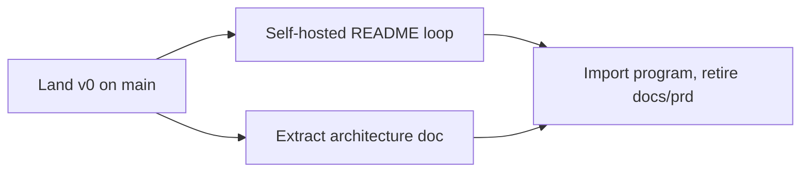

# L3 · sf6 — Self-hosting cutover

> Child of umbrella **software-factory** (`../software-factory/PRD.md`). Depends on L0–L2 (sf0–sf5), all of which are complete.

## Objective

Hand this repository over to the factory:

1. **Land v0 on `main`.** Push `feat/software-factory`, open a PR, and have the human merge it with a merge commit. Then remove the branch-only unsigned-commit `includeIf`.
2. **Run one real self-hosted loop.** The factory daemon runs on this repo. A work item, *"Document the factory in README.md"*, is added with `factory add` and started with `factory start`. It goes through the whole loop for real: an omp executor builds, `npm test --prefix factory` runs, the `openai-codex` reviewer reviews, a PR opens, the human gives `factory approve`, `gh` squash-merges, and the retro and a `factory: state` commit land on `main`.
3. **Extract the living design doc.** The umbrella's Architecture, Constraints, and Discussion move into `docs/factory/architecture.md`, with an ADR-style decision log.
4. **Import and retire.** `factory import docs/prd/software-factory` loads the program into the factory DB: sf0–sf5 as `done`, sf6 marked `done`, and sf7–sf12 as draft `prd` items, which become the parents of future L4 work. Then `docs/prd/` is deleted. From here on the factory is the only tracker, and L4 is planned in the harness with `factory add`.

**Done when:**
- `main` contains the factory and the merged README item.
- The README item is `done` in the factory, with a retro row.
- `docs/factory/architecture.md` exists.
- `docs/prd/` is gone.
- `factory status` shows the imported program.

## Motivation

This is the bootstrap's acceptance test, the point where *"we should be able to use software-factory to make changes to software-factory"* becomes true. It is also where the YAML workflow ends, so the knowledge it carries (architecture and decisions) has to survive in a form that executors and the future planner (sf8) will read.

## Implementation Details

### Architecture

#### Order

#### Self-hosted loop runbook (task 2)

1. `git switch main && git pull` in the user checkout. The daemon runs from this checkout's `factory/` code.
2. Start `node factory/src/daemon/main.ts` in the foreground as a long-lived session service, on the default port 7317. Expect `.factory/main` to be created (detached at `origin/main`) and `.factory/live/factory.db` to be seeded or created.
3. `npm run build:ui --prefix factory`, then open `http://127.0.0.1:7317` to watch.
4. `factory add --type task --tier light --ready --title "Document the factory in README.md" --body "<the README spec below>"`, then `factory start <id>`.
5. Watch the build, test, review, and PR nodes. On the merge gate, the human reviews the PR on GitHub and runs `factory approve <gate-id>`, or `reject` with a note.
6. Verify:
   - the item is `done`;
   - the run is `completed` with `pr_url`;
   - a retro row exists;
   - `origin/main` has the squash-merge commit and a `factory: state` commit;
   - the worktree and the remote branch are gone;
   - the user checkout is untouched until `git pull`.
7. If a failure gate opens, the human decides (retry or reject). Every failure is recorded in the sf6 log and becomes an L4 bug item later. The loop counts as passed only once one item has gone all the way to merged.

**README item body.** This is the work item's spec, given inline with `--body` because L4-style items have no spec files. It asks for a new `## Software factory` section in `README.md`, with these parts:
- **What it is**: a local daemon that runs build → test → review → PR → merge gate → merge → retro over omp sessions.
- **Layout**: `factory/` and `factory/ui`.
- **Requirements**: Node ≥ 24.15, omp, gh, git, and yq+jq for import.
- **Run it**: `node factory/src/daemon/main.ts` or `npm run daemon --prefix factory`; `npm link --prefix factory` for the `factory` CLI.
- **The CLI commands.**
- **The UI**: `npm run build:ui --prefix factory`, at `http://127.0.0.1:7317`.
- **Configuration**: `.factory/config.json`, roles, caps, `loop.maxParallel`.
- **Where state lives**: `.factory/factory.db` is committed, the daemon is its single writer, and the `factory: state` commits are unsigned.
- **An optional systemd `--user` unit snippet.**

Also update the Layout tree at the bottom of the README. Do not touch the skills sections beyond a pointer to the factory. Test command: the default (`npm test --prefix factory`).

#### Import and retire (task 4)

1. With the daemon running, `factory import docs/prd/software-factory`.
2. Check the import:
   - 1 umbrella, 13 `prd`, 9 groups, 23 tasks;
   - sf0–sf5 tasks `done`;
   - the sf6 tasks come in as `ready` (still in progress in YAML at import time); PATCH them to `done` with `from: 'ready'`, one per item, through the API;
   - sf7–sf12 stub `prd` items stay `draft`;
   - the umbrella, group, and prd container statuses are recomputed by roll-up only when an item changes, so PATCH any container left inconsistent.
3. Once the sf6 tasks are marked complete in YAML, `git rm -r docs/prd`. Commit and push to `main` (a human-authored commit, signed as usual) with the message `chore: retire YAML PRDs; factory is the tracker`. Keep `.claude/prd-root`.
4. Stop the daemon with SIGTERM. Its shutdown flush commits the imported state (`factory: state (shutdown)`). `git pull` afterwards.

### Constraints

- The factory code that runs is the code on `main` in the user checkout. After any merge that touches `factory/`, restart the daemon; it logs a hint when this is needed.
- Use the default caps ($5, 30 min per session; `maxParallel` 2) and the roster from `.factory/config.json`. The first loop is a `light`-tier item (`anthropic/claude-haiku-5-5`), and its reviewer is `openai-codex/gpt-6.2-sol`. Both were verified to authenticate on 2026-11-22.
- Order matters: `.factory/main` is detached at `origin/main`, so **task 1 must be merged before task 2 starts**, or the executor's `npm test --prefix factory` has nothing to run.
- Human-authored commits (tasks 1, 3, and 4) keep the user's normal signing once the `includeIf` is removed. Only factory-made commits are unsigned.
- `docs/factory/architecture.md` is a living doc. The future planner (sf8) and the retro learn-gate (sf10) are expected to read and update it.

### Relevant Guides

- `../software-factory/PRD.md`: the source for the architecture doc
- `factory/src/cli/main.ts` (usage text), `.factory/config.json`, and the sf3 PRD import mapping table
- `README.md`: the current layout and the skills docs

### Relevant Files

- `README.md` - (Edit) by the factory's own executor (task 2)
- `docs/factory/architecture.md` - (Create) (task 3)
- `docs/prd/` - (Delete) (task 4)
- `.git/config` - (Edit, local) remove `includeIf.onbranch:feat/software-factory.path`; delete `.git/unsigned-feature-branch.inc`
- `.factory/factory.db` - (Create) committed by the daemon's state commits

## Discussion

### Landing v0

_v0 is on an unpushed feature branch, and executors branch from `origin/main`. How does it land?_

Push the branch, open a PR with `gh`, and the human merges it with a **merge commit** so the per-task history stays. After that, remove the branch-only unsigned `includeIf`.

### L4 planning before a planner exists

_The factory's planner is itself L4 (sf8). Who plans sf7–sf12 until then?_

Plan in the harness and add each L4 task with `factory add --title … --body …`. There are no YAML or spec docs for L4; the imported sf7–sf12 stub items are their parents.

### First self-hosted loop

_Which item proves the factory can build itself?_

"Document the factory in README.md". It is a real sf6 deliverable with little code risk, and it still exercises tests, review, PR, merge, retro, and the state commit.

### Retiring YAML PRDs

_Freeze `docs/prd/`, or delete it?_

Delete `docs/prd/` after a successful import; git history keeps it. Keep `.claude/prd-root`. Before deleting, extract the umbrella's Architecture, Constraints, and Discussion into a living `docs/factory/architecture.md` with an ADR-style decision log, so executors and the future planner keep the design context.

### Daemon runtime for the cutover

_Default chosen without a question._

Run the daemon in the foreground as a service of the driving session. A systemd `--user` unit is documented in the README as optional.
