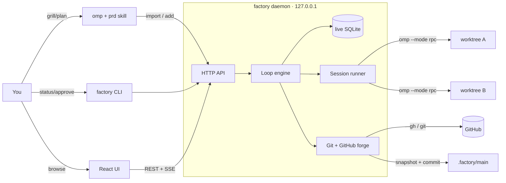
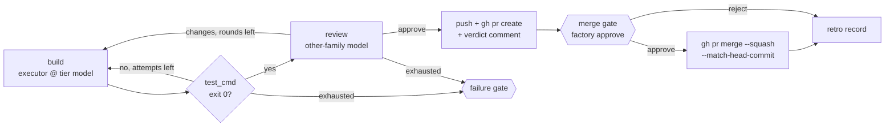

# software-factory

## Objective

Upgrade the `prd` skill into a software factory: a local system that manages Software Development Lifecycle (SDLC) loops as directed acyclic graphs (DAGs), from intake to merge to learning.

As a user, I tell my harness (omp) "I want to build some feature into the system". The factory works *with me*. It grills me on the intent, researches, produces decisions, wireframes, prototypes, and plans, and iterates toward a solution. Once a plan is reviewed and approved, the factory builds what was planned.

The abstract loop is: **Intake → Plan → Split → Build → Verify → Merge → Learn**.

- **Intake**: a ticket, prompt, alert, issue, or PR request.
- **Plan**: turn the intent into a design and tasks.
- **Split**: order the tasks by dependency and priority.
- **Build**: executors work in parallel.
- **Verify**: tests, CI, and review agents check the work.
- **Merge**: the work lands where it was meant to land.
- **Learn**: the results are saved and feed the next loop.

**Loops nest.** Any loop can spawn child loops, and a child's output may be a decision, documentation, a wireframe, or code that the parent loop needs. Example: the big loop "build an asset manager application" spawns smaller loops: "it's a React webapp" (decision), "update the design system", "user-experience wireframes", then the build loops.

Principals:
- **Human**: briefs and approves. Describes the problem, answers the planner's questions, and approves or gives feedback on designs and plans at gates.
- **Planner**: grills, researches, and plans. Reads the code and the systems, then writes small steps with acceptance criteria and tests. A different model family reviews them.
- **Orchestrator**: runs the plan. It is a service, not a model. It opens work items, starts a session for each ready step, routes reviews, merges, and unblocks dependents.
- **Executors**: each builds one step, using the cheapest model that fits.

**Success for v1:** software-factory is its own first target. The factory can run the full nested loop on itself: plan a change to software-factory with me, build it, verify it, merge it, and record what it learned. Both kinds of loop must work in v1: a small one (e.g. a dependency update) and a large one that spawns child loops.

## Motivation

- Agent-assisted development today is ad-hoc. Each session is a one-off, nothing tracks the overall program, and lessons are lost between sessions. The current `prd` skill (bash + YAML) gives the work structure, but it can't run work in parallel, enforce gates, route models, or learn.
- Existing factories (Archon, ai-software-factory) provide the concepts, such as YAML DAG workflows, worktree isolation, and approval waits, but not the goals I want: an enterprise-class SDLC with UI/UX for review in the form of issue organization and tracking (JIRA-like), interactive planning with the human, and design/prototype loops before any code is written. Neither has a real learning loop. So the factory is built, not adopted. Archon is a reference for ideas only.
- Being able to build itself is the proof that it works. If the factory can't improve itself, it isn't ready for other projects.

## Implementation Details

### Architecture

This section covers the cross-cutting design shared by every child PRD. Each child owns the detailed design of its own slice.

#### Process model

- **`factory daemon`** is one Node process per repo. It enforces a single instance by binding `127.0.0.1:<port>` (default 7317, set in config), which needs no stale-lock handling. It serves the JSON API, the SSE stream at `/events`, and the built UI. On SIGTERM/SIGINT it stops accepting work, sends SIGTERM to each executor process group, then SIGKILL after a grace period. An optional systemd `--user` unit (`KillMode=control-group`) is the backstop if the daemon crashes.
- **`factory` CLI** is a thin HTTP client: `daemon`, `status`, `show`, `add`, `import`, `start`, `approve`, `reject`. It never opens the DB.
- **UI**: Vite + React, built to static files that the daemon serves with SPA fallback. It reads REST snapshots, then follows `/events`. The SSE `id` is the event `seq`; `Last-Event-ID` replays missed events. v0 is read-only.

#### Git topology

| Path | Tracked? | Owner | Purpose |
|------|----------|-------|---------|
| `.factory/factory.db` | committed | daemon (via snapshot) | Source of truth, shared by clones |
| `.factory/config.json` | committed | human | Port, role→model map, caps, default test command |
| `.factory/main/` | gitignored | daemon | Worktree at **detached HEAD = origin/main**. Your checkout already has `main` checked out, and a branch can be checked out only once. Pushes go out as `git push origin HEAD:main`. |
| `.factory/live/` | gitignored | daemon | Live WAL DB (`factory.db`, `-wal`, `-shm`) |
| `.factory/worktrees/<item>-<attempt>/` | gitignored | executor | `git worktree add --lock -b factory/<item>-<attempt> <path> origin/main` |
| `.factory/sessions/` | gitignored | omp | Full transcripts (`--session-dir`); the DB stores only the path |

- **Snapshot and commit**: at each milestone (gate opened or closed, merge, retro), the daemon runs `VACUUM INTO '<tmp>'`, renames the result over `.factory/main/.factory/factory.db`, commits, and pushes. On startup, if `live/` is missing, it seeds from the committed file.
- **One git queue**: every fetch, pull, merge, commit, and push in `.factory/main` goes through one in-process FIFO. Executors only commit on their own branch, and the daemon pushes those branches. The user's checkout is never touched; you `git pull` to see the factory's work.

#### Data model (sketch; `f0` owns the final schema)

Modeled on Archon: CAS status updates (`UPDATE … WHERE status = ?`, then check `changes = 1`), an append-only events log, and durable gates.

- `work_items(id, parent_id, type, title, body, spec_path, tier, test_cmd, status, source_ref, created_at, updated_at)`: a generic tree with a free `type` label.
- `item_deps(item_id, depends_on_id)`: the DAG edges.
- `runs(id, item_id, template, attempt, status, branch, worktree, pr_number, head_sha, cost_usd, started_at, ended_at)`, where status is one of `pending|running|paused|completed|failed|cancelled`.
- `node_runs(run_id, node, iteration, status, model, session_file, cost_usd, started_at, ended_at, output)`, where status is one of `pending|running|completed|failed|skipped`.
- `gates(id, run_id, node, kind, question, recommendation, opened_at, closed_at, decision, note)`.
- `events(seq INTEGER PRIMARY KEY, item_id, run_id, node, type, data, at)`: the SSE source.
- `retros(run_id, failures, findings, rework_count, cost_usd, duration_s, notes)`.
- `meta(schema_version)`: forward-only migrations.

#### The v0 loop template (`change`)

- **Code decides when work is done.** `prompt_result.status:"completed"` only means the session ended. The node succeeds only if `test_cmd` exits 0 in the worktree, the branch has at least one new commit, and (for review) the reviewer's verdict JSON says `approve`.
- **Daemon timeout**: the daemon owns the wall-clock timer and sends `abort` when it expires. `--max-cost` is passed through, and a `cost_cap` error counts as a failed attempt. Defaults: 30m and $5 per session, from config.
- **Restart**: on startup, runs left `running` mark their node `failed` (interrupted). The node is re-dispatched into the preserved worktree with a "resuming" prompt, the factory's version of WorkPRD Step 0.
- **Import**: `factory import <prd-dir>` maps a `tasks.yaml` onto work items. Top-level entries depend on the previous one; subtasks depend only on their parent's predecessors. Umbrella leaves become parent items of their child PRD's tasks.

### Constraints

**Scope and deployment**
- One user on a local workstation. There is no user model, auth, or multi-tenancy. The factory DB and research docs are committed to the repository and shared by anyone who clones it.
- A service that accepts inbound or remote requests is out of scope. The daemon listens on localhost only.
- The repo `msnow-skills` becomes a monorepo: `skills/` (the evolving `prd` and `breakdown` skills) plus the factory (daemon, CLI, UI, schema).

**Runtime**
- A local daemon runs the DAGs and serves the UI. The CLI and the harness (omp, through the evolved skill) are its clients.
- Stack: TypeScript on Node ≥ 24.15. The daemon and CLI use the built-in `node:sqlite`: zero runtime dependencies, RC stability since v24.15, verified on v24.16 with no warning. They form one npm package in `factory/`, tested with `node:test`.
- UI stack: React 19 built by Vite 8, using shadcn/ui on Tailwind v4 and TanStack Router with file-based routes. The UI is its own devDependency-only package at `factory/ui`, built by `npm run build:ui --prefix factory`.
- TypeScript runs through Node's built-in type stripping, with no build step for the daemon or CLI. Only erasable syntax is allowed: no `enum`, runtime `namespace`, or parameter properties. Imports use explicit `.ts` extensions and `import type`. tsconfig: `noEmit`, `module: nodenext`, `erasableSyntaxOnly`, `verbatimModuleSyntax`, `allowImportingTsExtensions`; type-check with `tsc`. Run tests with an explicit glob, `node --test 'src/**/*.test.ts'`, because the default glob also runs every `.ts` file under `test/`.

**Storage**
- A SQLite database committed to the repo is the source of truth for work items, DAGs, runs, gates, and retro records.
- Only one process writes the DB: the daemon on the main checkout. Executors in worktrees never write the DB; they report back through the daemon.
- Risk: a committed binary DB can't be diffed or merged. If two clones run daemons, their DBs diverge and conflict on pull. This is accepted for single-user use.
- Risk: the daemon commits DB changes on the same checkout that receives merges, so DB commits and merges must be serialized and never race.
- Long-form artifacts (research, decisions/ADRs, conventions, wireframes, retros) are committed docs in the repo.

**Workflow model**
- DAGs are hybrid. A library of loop templates defines the loop types: node kinds, gates, and verify steps. The planner composes and nests templates for each intake, and the human approves the result at the plan gate.
- Work items form a generic tree. Each node has a free `type` label (e.g. initiative, objective, epic, issue, task, bug) and can nest to any depth. The UI groups by type, and the mapping to external trackers (JIRA) happens at sync time.
- Gates are configurable per node. By default the human approves the plan, each merge, and any reviewer disagreement or repeated check failure. Everything else runs unattended.

**Execution**
- The daemon drives `omp --mode rpc` directly, one git worktree per task. Other harnesses (Claude Code, Codex) and session managers (aoe, herder) are out of scope for v1.
- Model routing is a static config that maps roles (planner, executor size tiers, reviewer) to models. The planner assigns each task a tier. Dynamic discovery (llmfit, local llama.cpp endpoints) is out of scope for v1.
- Review: every change gets at least one reviewer from a different model family than the author.

**Execution facts (research and local verification)**
- omp RPC is NDJSON over stdio. Wait for the `{"type":"ready"}` frame. A `prompt` is acknowledged by a `response`, and its outcome comes in `prompt_result{status: completed|aborted|error, error.code}`. Cost comes from `get_session_stats`: `data.cost` in USD. Drain stdout continuously and ignore unknown frame types.
- `--max-time` is **not** used. Locally it ended a run with `status:"completed"` and gave no signal that time ran out. `--max-cost` produces `prompt_result.status:"error"` with `code:"cost_cap"`, and can overshoot by one request.
- Executors run with `--approval-mode yolo --no-ui` (approval prompts fail closed instead of hanging), `--session-dir .factory/sessions`, and `--model` from the role map. They are spawned `detached`, so a process-group kill reaches grandchildren.
- `gh`: always pass `--title` and `--body-file` (non-interactive), and merge with `gh pr merge <n> --squash --match-head-commit <sha>`. **Never** use `--delete-branch`, which has worktree-removal bugs (cli/cli#14537); the daemon removes the worktree and branch after `state == MERGED`. The repo has no CI, and `gh pr checks` exits 1 when no checks exist, so read `gh pr view --json statusCheckRollup,mergeStateStatus,headRefOid` instead.
- git: create worktrees with `--lock`, run `git worktree prune` on startup, and only the daemon fetches. Linked worktrees share refs, packed-refs, and config, so contention is avoided by funnelling those operations through the one git queue.
- Signing: factory commits are **unsigned**. Every daemon commit passes `DAEMON_COMMIT_FLAGS` (`git.ts`), which sets the factory identity and `-c commit.gpgsign=false`, because the user's global 1Password SSH signer hangs or fails when unattended. Executor branch commits reach `main` only through GitHub's squash merge, which GitHub signs. Only the `factory: state` commits land on `main` unsigned.

**Learn**
- When a loop closes, a retro step writes a structured record to the DB: failures, review findings, rework count, cost, and time. It also proposes edits to committed knowledge: ADRs, decisions, conventions, loop templates, and agent prompts. The human approves or rejects the proposals at a gate. The planner reads this knowledge when it plans.

**Planning surface**
- The grilling and planning conversation happens in the harness (omp), through the evolved skill, which writes to the daemon. The UI is for navigation, review, and approval: the work-item tree, DAG status, diffs, gates, and the inbox.

**Integrations and tools**
- v1 integrates with GitHub only: branches, PRs, CI status, and merges via `gh`. JIRA and Confluence are out of scope for v1.
- Deterministic tools: graphify and codebase-memory-mcp. Language servers come through omp.

**Bootstrap**
- The current `prd` skill (YAML + WorkPRD) builds a minimal v0: the daemon, the DB, an engine that runs one DAG, and the CLI. Once v0 can run one loop on itself, the remaining tasks are imported into the factory DB, and from then on all work on the factory goes through the factory. After that, the YAML PRDs in this repo are retired.

**Shape**
- This is an **umbrella PRD**.
- **L0–L3** build v0 and are planned and worked as YAML PRDs:
  - L0: core
  - L1: runner, forge, CLI/import, UI
  - L2: loop engine
  - L3: self-hosting cutover
- **L4** is the v1 backlog. It is gated by `plan_after_prior` and is never planned in YAML. The L3 cutover imports it into the factory, where it is planned and built.

### Relevant Guides

- `../../../software-factory.md`: original brief
- `research.yaml`: answered research with citations (reference only; findings are folded into this PRD)
- omp RPC protocol: https://github.com/can1357/oh-my-pi/blob/main/docs/rpc.md · approval modes: https://github.com/can1357/oh-my-pi/blob/main/docs/approval-mode.md
- Node `node:sqlite`: https://nodejs.org/docs/latest-v24.x/api/sqlite.html · TypeScript: https://nodejs.org/docs/latest-v24.x/api/typescript.html · test runner: https://nodejs.org/docs/latest-v24.x/api/test.html
- SQLite `VACUUM INTO`: https://www.sqlite.org/lang_vacuum.html · WAL: https://www.sqlite.org/wal.html
- git worktree: https://git-scm.com/docs/git-worktree
- gh: https://cli.github.com/manual/gh_pr_create · https://cli.github.com/manual/gh_pr_merge · https://cli.github.com/manual/gh_pr_view
- SSE: https://html.spec.whatwg.org/multipage/server-sent-events.html · Vite build: https://vite.dev/guide/build
- Archon state model (reference only): https://github.com/coleam00/Archon/blob/dev/packages/core/src/db/adapters/sqlite.ts, `packages/workflows/src/schemas/{run-status,node-state,loop,wait-node}.ts`

### Relevant Files

- `factory/` - (Create) The factory package: `package.json`, `tsconfig.json`, `src/{shared,daemon,cli}/`, `ui/`
- `.factory/` - (Create) Committed `factory.db` and `config.json`, plus a `.gitignore` for `main/`, `live/`, `worktrees/`, `sessions/`
- `README.md` - (Edit) Document the monorepo layout and the factory
- `skills/prd/agents/prd-worker.md` - (Review) Base for the executor prompt: status ownership, checkpoints, and acceptance criteria
- `skills/prd/schemas/tasks.schema.json` - (Review) Import input contract
- `skills/prd/scripts/lib/umbrella-lib.sh` - (Review) Umbrella and child resolution rules the importer must match
- `docs/prd/software-factory/` - (Edit) This umbrella and its child PRDs

## Discussion

### Build vs. adopt Archon

_Archon (MIT, very active) already has YAML DAG workflows, a local SQLite service, a web console with an attention queue, a worktree per run, GitHub issue→PR→merge, and Pi as a provider. Adopt it as the engine, build our own, or fork it?_

Build. Archon presents concepts, but not the specific goals I want. An enterprise-class SDLC needs UI/UX for review in the form of issue organization and tracking, e.g. JIRA.

### Users and deployment

_Single-user local daemon, single-user but designed for teams, or multi-user shared server?_

Single-user, but technically user-less. A SQLite database and research documentation saved to the repository are used by everyone. A running service that handles incoming requests may come eventually but is not in scope.

### v1 definition of done

_Small loop (dependency update → merge) first, the big loop (feature with design) first, or both?_

The loop is the loop. A big loop can run smaller loops whose outputs are decisions, documentation, wireframes, or whatever else the larger plan needs. E.g. (big) "I want to build an asset manager application"; (small) "it's a React webapp"; (small) "updates to a design system"; (small) "user experience wireframes". The first real target is software-factory itself: we should be able to use software-factory to make changes to software-factory.

### Source of truth

_Text files as truth with SQLite as a derived index, a committed SQLite single-writer, a committed SQLite multi-writer, or a SQL text dump? (Risk: worktrees each carry a copy of a binary DB that git cannot merge.)_

A committed SQLite DB is the source of truth, with a single writer: the orchestrator on the main checkout. Worktrees never write it.

### Code location

_A new repo with the skill as a client, a monorepo in this repo, or a new repo that replaces the skill?_

This repo becomes a monorepo: `skills/` plus the factory.

### Orchestrator runtime

_On-demand CLI, harness-driven, or local daemon?_

All of these, combined: a local daemon on the workstation runs the DAGs and serves the UI, and the CLI and the harness interact with it.

### Human approval

_Approve literally every step, use configurable gates, or approve the plan only?_

Configurable gates per node. The defaults are plan approval, merge approval, and reviewer disagreement or repeated check failure.

### PRD name and root

_Name and location?_

`software-factory`, under `docs/prd` (persisted to `.claude/prd-root`).

### Bootstrap

_How does the factory build itself before it exists?_

The `prd` skill builds a minimal v0. Once v0 can run one loop on itself, the remaining tasks are imported into the factory, and the factory builds the rest. After that, the YAML PRDs are retired.

### DAG source

_Fixed templates, planner-generated graphs, or a hybrid?_

Hybrid: a library of loop templates that the planner composes and nests, approved at the plan gate. The set of v1 loop types is left to planning.

### Work-item hierarchy

_Fixed levels (Initiative → Objective → Epic → Issue → Task, Bug), a generic tree, or loop = work item?_

A generic tree with a free `type` label. Mapping to JIRA happens at sync time.

### Integrations

_GitHub only, none, GitHub + JIRA, or all three?_

GitHub only for v1.

### Session backend

_Drive `omp --mode rpc` directly, go through aoe (tmux-attachable), or multi-harness from v1? (Research: herder does not support Pi/omp; aoe is not installed.)_

The daemon drives `omp --mode rpc` directly, one worktree per task.

### Model routing and review

_Static role/tier config, dynamic discovery-based routing, or a single model? What review requirement?_

A static role and tier config. One reviewer from a different model family than the author.

### Learn

_A retro record plus proposed knowledge edits behind a gate, metrics only, or auto-applied edits?_

A retro record in the DB, plus proposed edits to ADRs, conventions, templates, and prompts. The human approves them at a gate, and the planner reads them.

### Planning surface

_Where does the grilling and planning conversation happen: harness, UI chat, or both?_

In the harness (omp), through the skill. The UI is for navigation, review, and approval.

### Deterministic tooling

_graphify only, graphify + codebase-memory-mcp, or none?_

Both graphify and codebase-memory-mcp. Language servers come through omp.

### Stack

_TypeScript/Bun, TypeScript/Node, Python, or Go/Rust?_

TypeScript on Node, with a React UI. The SQLite driver was revisited during planning (see "SQLite driver").

### Planning depth (PlanPRD)

_How much gets planned as YAML PRDs, given that the factory takes over after v0?_

Umbrella PRD. L0 is the v0 bootstrap, split into child PRDs that are fully planned now. L1+ are v1 capabilities, listed as stub leaves gated by `plan_after_prior`. They are never planned in YAML; they are imported into the factory as its first backlog.

### v0 scope (PlanPRD)

_What is the smallest v0 that can run one loop on itself: CLI-only with one template and import-based planning, plus a read-only UI, or plus direct planner writes?_

CLI loop with one hard-coded template, import-based planning, **plus a minimal read-only React UI** showing the work-item tree and run status.

### Daemon checkout (PlanPRD)

_Where does the daemon commit the DB and merge: a dedicated worktree, the user's checkout, or GitHub only with a state branch?_

A dedicated, gitignored worktree on `main` owned by the daemon. DB commits and merges are serialized through one in-process queue, and the daemon pushes to `origin` after every merge. The user's checkout is never touched.

### Merge path (PlanPRD)

_How does an approved change reach `main`: a PR with the merge gate in `factory approve`, a local squash merge, or a PR approved on GitHub?_

Through a PR. When verification passes, the daemon pushes the branch and opens a PR with `gh`, posting the review verdict as a PR comment. On `factory approve` it runs `gh pr merge --squash`, pulls in its own worktree, then commits the DB and pushes. (Facts: `corgeeks/msnow-skills` has no branch protection and no CI; squash merges are allowed.)

### Executor permissions (PlanPRD)

_How much permission and spend do unattended executors get?_

`--approval-mode yolo` inside the worktree, capped per task by `--max-time` and `--max-cost` from config (default 30m and $5). A cap hit counts as a failed attempt and goes to a gate. The risk is accepted: the agent runs as the local user, and the worktree is not a sandbox.

### Model roster (PlanPRD)

_Which model fills each role? omp offers the anthropic and openai-codex families; there are no local models._

| Role | Model |
|------|-------|
| Planner | `anthropic/claude-opus-5-5` |
| Executor: Heavy | `anthropic/claude-opus-5-5` |
| Executor: Standard | `anthropic/claude-sonnet-5-5` |
| Executor: Light | `anthropic/claude-haiku-5-5` |
| Reviewer (anthropic author) | `openai-codex/gpt-6.2-sol` |
| Reviewer (openai-codex author) | `anthropic/claude-opus-5-5` |

The v0 task specs carry these as "Suggested Model". The harness for building v0 is omp, through WorkPRD.

### Monorepo layout (PlanPRD)

_A single npm package or npm workspaces? Which test runner?_

A single npm package in `factory/`: `src/daemon`, `src/cli`, `src/shared`, and `ui/` (Vite + React, built to static files served by the daemon). One `package.json`. Tests use `node:test`. The CLI talks to the daemon over localhost HTTP.

### SQLite driver (PlanPRD)

_Research found Node 24's built-in `node:sqlite` (RC since v24.15; verified on the local v24.16 with no warning, SQLite 3.53, `VACUUM INTO` works). Use it instead of `better-sqlite3`?_

Yes. Use `node:sqlite`, which means zero runtime dependencies, with `engines.node >= 24.15`.

### Dispatch policy (PlanPRD, L1/L2)

_When does a ready item start running, and how many run in parallel?_

Start is explicit. `factory start <id…|--all>` moves items `ready → queued`; from then on the engine dispatches each one as its dependencies finish. At most 2 executors run in parallel (`loop.maxParallel`). This adds the `queued` status to sf0's contract.

### DB commit cadence (PlanPRD, L1/L2)

_How often does the daemon commit the DB to `main`?_

At milestones, debounced by 60 s, plus immediately after every merge. The commit prefix is `factory: state`.

### Live activity (PlanPRD, L1/L2)

_Should the UI show live executor activity?_

Yes, as transient tool-call lines over SSE (`event: activity`, no `id`). They are never persisted.

### UI foundation (PlanPRD, L1/L2)

_Which UI kit and router?_

shadcn/ui, whose MCP is registered for agent sessions through `.mcp.json`, with TanStack Router on file-based routes. `factory/ui` is its own package with devDependencies only. Note: TanStack Router uses the History API; the Navigation API (Baseline 2026, newly available) is not used directly.

### Commit signing (WorkPRD, L1)

_The user's global config signs commits through 1Password SSH, which fails unattended. How should factory commits, and the v0 build commits, be signed?_

Factory commits are unsigned (`commit.gpgsign=false` through `DAEMON_COMMIT_FLAGS`). The v0 build commits are unsigned too, limited to the `feat/software-factory` branch by `includeIf "onbranch:feat/software-factory"` in `.git/config` pointing at `.git/unsigned-feature-branch.inc`. Remove that include after the branch is merged.

### References

- Source brief: `../../../software-factory.md`
- https://github.com/coleam00/Archon: worth borrowing `until_bash` loops (code decides when work is done), durable approval waits in an attention queue, and a worktree per run that preserves its branch on abandonment.
- https://github.com/coleam00/ai-software-factory: worth borrowing evidence-backed review verdicts and holdout tests the builder cannot see. Lesson learned: a 140-node lifecycle was replaced by a simple builder→reviewer loop, and checks were scaled to risk after laps took about 3.7 hours per merge.
